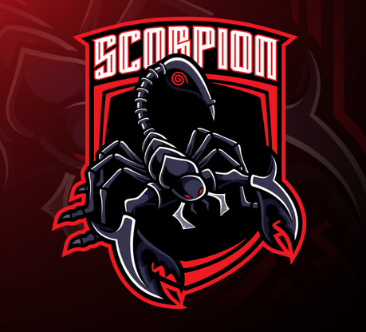

# Welcome to SCORPION HACK WEBKIT PS4 9.00

    
  

## 🦂 PSFree: Scorpion Edition v1.5.0b
**Lapse Kex ported to FW 9.00** ⚡
* Very fast and highly reliable! 
* Achieves around an **80% stability rate** out of the box.

---

### 🚀 Latest Updates
* **AIO Bug Patches:** Added a payload containing crucial `process_dtor_handler` patches related to AIO bugs. 
* **Fixes applied:** All games should now work properly under this environment. 
* *Patches were originally built by abc for 8.0x and successfully ported to 9.00 by Scorpion.*

---

### 📁 Exploit Architecture
PSFree is a high-performance collection of exploits optimized primarily for the PS4 console, with portability enhancements targeted for the PS5.

| Component | Source Path | Description |
| :--- | :--- | :--- |
| **WebKit Exploit** | `src/psfree.mjs` | Primary execution chain interface |
| **Kernel Exploit** | `src/scripts/lapse.mjs` | Lapse Kernel Exploit integration |

---

### 🤝 Credits & Acknowledgments
* **Sistro & CTN:** Big thanks for providing low-level coding explanations that made these optimizations possible!
* **anonymous:** For tracking down and providing critical PS4 firmware kernel dumps.
* *Check individual files for extra contributors. Unless stated otherwise, core updates are maintained here.*

---

### 📜 Copyright & Licensing
Distributed under the **AGPL-3.0-or-later** license (see `src/COPYING` for full terms). This repository belongs upstream to the `anonymous` group, and anonymous contributors are fully credited under the same designation.
